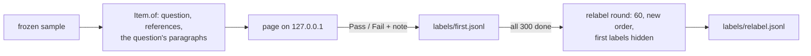

PR: [bhavya94/llm-judge-vs-expert-labels#2](https://github.com/bhavya94/llm-judge-vs-expert-labels/pull/2)

# Stack 2/3: the labeling page and the blind relabel round

## Summary
The person's labels are the ground truth for every judge in this project, so the labeling setup must not bias them.
This PR ports the reflection project's parked labeling page. It shows one answer at a time with everything needed
to judge it, and nothing that names the writer. A blind second pass over 60 answers measures how far the person
agrees with themselves. That number is the ceiling for every judge.

## How it works

- [`src/llm_judge_vs_expert_labels/data/corpus.py:54`](https://github.com/bhavya94/llm-judge-vs-expert-labels/blob/6f985a91563bbdb9cdb86ca5014cb1d5dd4ba270/src/llm_judge_vs_expert_labels/data/corpus.py#L54) builds one paragraph set per question: every paragraph any
  writer saw or cited, plus the expert evidence, in paper order. Every answer to that question shows the same set.
- [`src/llm_judge_vs_expert_labels/labeling/items.py:33`](https://github.com/bhavya94/llm-judge-vs-expert-labels/blob/6f985a91563bbdb9cdb86ca5014cb1d5dd4ba270/src/llm_judge_vs_expert_labels/labeling/items.py#L33) builds what the page shows. It holds no writer and no
  answer-F1, so neither can reach the page.
- [`src/llm_judge_vs_expert_labels/labeling/labels.py:26`](https://github.com/bhavya94/llm-judge-vs-expert-labels/blob/6f985a91563bbdb9cdb86ca5014cb1d5dd4ba270/src/llm_judge_vs_expert_labels/labeling/labels.py#L26) refuses a Fail without a note. The notes become failure modes.
- [`src/llm_judge_vs_expert_labels/labeling/labels.py:50`](https://github.com/bhavya94/llm-judge-vs-expert-labels/blob/6f985a91563bbdb9cdb86ca5014cb1d5dd4ba270/src/llm_judge_vs_expert_labels/labeling/labels.py#L50) reads the append-only file; the newest label of an answer wins.
- [`src/llm_judge_vs_expert_labels/labeling/server.py:49`](https://github.com/bhavya94/llm-judge-vs-expert-labels/blob/6f985a91563bbdb9cdb86ca5014cb1d5dd4ba270/src/llm_judge_vs_expert_labels/labeling/server.py#L49) starts the relabel round only after the first pass is
  complete. It takes a seeded 60 in a new order and saves to its own file.
- [`src/llm_judge_vs_expert_labels/labeling/server.py:100`](https://github.com/bhavya94/llm-judge-vs-expert-labels/blob/6f985a91563bbdb9cdb86ca5014cb1d5dd4ba270/src/llm_judge_vs_expert_labels/labeling/server.py#L100) refuses a missing, negative or oversized body.
- [`src/llm_judge_vs_expert_labels/labeling/template.html:132`](https://github.com/bhavya94/llm-judge-vs-expert-labels/blob/6f985a91563bbdb9cdb86ca5014cb1d5dd4ba270/src/llm_judge_vs_expert_labels/labeling/template.html#L132) leaves the note box after a save. Without it, the next
  shortcut typed into the next answer's note.
- [`src/llm_judge_vs_expert_labels/cli.py:55`](https://github.com/bhavya94/llm-judge-vs-expert-labels/blob/6f985a91563bbdb9cdb86ca5014cb1d5dd4ba270/src/llm_judge_vs_expert_labels/cli.py#L55) holds back Pass/Fail by writer and by F1 until the first pass is done.
- [`tests/test_labeling.py:37`](https://github.com/bhavya94/llm-judge-vs-expert-labels/blob/6f985a91563bbdb9cdb86ca5014cb1d5dd4ba270/tests/test_labeling.py#L37) checks that all answers to a question show the same paragraphs, in paper order.

## Decision log
| Decision | Options considered | Chosen | Why |
|---|---|---|---|
| Interface | Terminal; browser page | Browser, ported from the parked tool | Twenty paragraphs read badly in a terminal |
| Paragraphs shown | What this writer saw; one set per question | One set per question | The count revealed the writer: none, 5 or 20 |
| After a save | Reveal writer and F1; reveal nothing | Nothing | Over 300 labels, a reveal teaches which writers fail and pulls labels toward F1 |
| Failure modes | Fixed tags; free-text notes | Notes | Labelers' criteria change once they read outputs, so modes come from the notes |
| Relabel storage | Same file; own file | Own file | The newest row wins, so a shared file would overwrite first labels |

## Cost & risk
No API cost. The person's time is the cost: about one minute per answer, so about six hours for 360 labels.
- A closed-book answer always says "Cites nothing", which hints at the writer. Citations are part of what the
  labeler judges, so the hint stays.
- A crash during a save could leave a half-written line that stops the page loading. It is rare, and the fix is to
  delete that line.

## Open questions
- Self-agreement uses 60 answers, so its interval will be wide. More relabels would narrow it.
