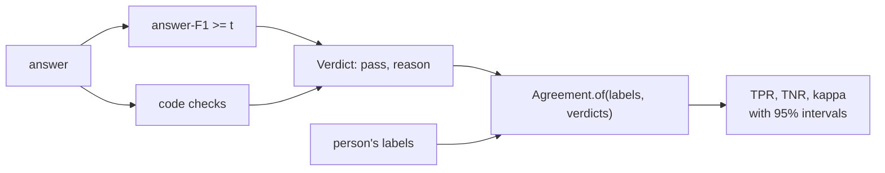

PR: [bhavya94/llm-judge-vs-expert-labels#3](https://github.com/bhavya94/llm-judge-vs-expert-labels/pull/3)

# Stack 3/3: code judges and agreement with intervals

## Summary
Every later judge, prompted or trained, needs a contract and a score. This PR adds both, plus the free baselines those
judges must beat. A judge takes one answer and returns Pass or Fail with a reason. Agreement with the person is TPR,
TNR and Cohen's kappa, each with a 95% bootstrap interval.

## How it works

- [`src/llm_judge_vs_expert_labels/judges/base.py:10`](https://github.com/bhavya94/llm-judge-vs-expert-labels/blob/3afead5e676d611e5f32d436fbfb95af314a1ebc/src/llm_judge_vs_expert_labels/judges/base.py#L10) is the verdict every judge returns.
- [`src/llm_judge_vs_expert_labels/judges/code.py:19`](https://github.com/bhavya94/llm-judge-vs-expert-labels/blob/3afead5e676d611e5f32d436fbfb95af314a1ebc/src/llm_judge_vs_expert_labels/judges/code.py#L19) is answer-F1 as a judge. F1 is the metric QASPER reports, so it
  is the baseline to beat.
- [`src/llm_judge_vs_expert_labels/judges/code.py:47`](https://github.com/bhavya94/llm-judge-vs-expert-labels/blob/3afead5e676d611e5f32d436fbfb95af314a1ebc/src/llm_judge_vs_expert_labels/judges/code.py#L47) runs the form checks in order and fails at the first.
- [`src/llm_judge_vs_expert_labels/evaluation/agreement.py:42`](https://github.com/bhavya94/llm-judge-vs-expert-labels/blob/3afead5e676d611e5f32d436fbfb95af314a1ebc/src/llm_judge_vs_expert_labels/evaluation/agreement.py#L42) scores verdicts against labels. One bootstrap resamples
  the labels and the verdicts together, so they stay paired.
- [`src/llm_judge_vs_expert_labels/cli.py:72`](https://github.com/bhavya94/llm-judge-vs-expert-labels/blob/3afead5e676d611e5f32d436fbfb95af314a1ebc/src/llm_judge_vs_expert_labels/cli.py#L72) scores every judge on dev only. Test waits for the final run.
- [`src/llm_judge_vs_expert_labels/cli.py:89`](https://github.com/bhavya94/llm-judge-vs-expert-labels/blob/3afead5e676d611e5f32d436fbfb95af314a1ebc/src/llm_judge_vs_expert_labels/cli.py#L89) adds the person's relabels against their first labels as the ceiling.
- [`tests/test_judges.py:52`](https://github.com/bhavya94/llm-judge-vs-expert-labels/blob/3afead5e676d611e5f32d436fbfb95af314a1ebc/tests/test_judges.py#L52) checks TPR, TNR and kappa against a worked example.

## Results
No labels exist yet, so only pass rates on the 200 dev answers:

| Judge | Passes |
|---|---|
| Code checks | 60% |
| answer-F1 >= 0.3 | 43% |
| answer-F1 >= 0.5 | 34% |
| answer-F1 >= 0.7 | 23% |

## Decision log
| Decision | Options considered | Chosen | Why |
|---|---|---|---|
| Agreement measures | Accuracy; TPR, TNR and kappa | TPR, TNR, kappa | Accuracy hides a judge that passes everything when most answers pass |
| Uncertainty | None; bootstrap intervals | Bootstrap | 200 answers leave wide intervals, and the write-up must show them |
| F1 thresholds | Tune on dev; report three | Three fixed | Shows how much the cut matters without tuning on labels |
| Test split | Scored by every command; held back | Held back | Test is used once, at the end |

## Cost & risk
No API cost. The code checks use the reference answers, as the labeler does, so they are stronger than checks a
judge could run without references.

## Open questions
- The 35-word limit comes from the reflection project's train split. A person may accept longer answers.
