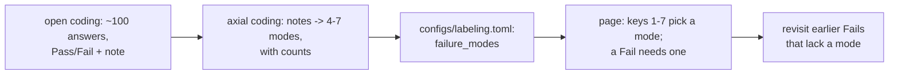

PR: [bhavya94/llm-judge-vs-expert-labels#4](https://github.com/bhavya94/llm-judge-vs-expert-labels/pull/4)

# Failure-mode tags after axial coding

## Summary
Error analysis says: read the outputs first, then name the failure modes. This PR builds the labeling page in that
order. The first 100 answers get free-text notes only. The notes are then grouped into 4–7 failure modes, and from
then on every Fail carries one. Each later judge for one failure mode trains and scores against these tags.

## How it works

- [`configs/labeling.toml:16`](https://github.com/bhavya94/llm-judge-vs-expert-labels/blob/8c579f9738caa000b58a174d0c49fcf6a42f964c/configs/labeling.toml#L16) starts as an empty list. Nobody writes it before reading the notes.
- [`src/llm_judge_vs_expert_labels/labeling/labels.py:25`](https://github.com/bhavya94/llm-judge-vs-expert-labels/blob/8c579f9738caa000b58a174d0c49fcf6a42f964c/src/llm_judge_vs_expert_labels/labeling/labels.py#L25) adds the tag to each label. Rows saved before tags existed
  load with an empty tag.
- [`src/llm_judge_vs_expert_labels/labeling/server.py:82`](https://github.com/bhavya94/llm-judge-vs-expert-labels/blob/8c579f9738caa000b58a174d0c49fcf6a42f964c/src/llm_judge_vs_expert_labels/labeling/server.py#L82) enforces the rule on the server, not only in the page: once
  modes exist, a Fail needs one of them, and a Pass takes none.
- [`src/llm_judge_vs_expert_labels/labeling/template.html:144`](https://github.com/bhavya94/llm-judge-vs-expert-labels/blob/8c579f9738caa000b58a174d0c49fcf6a42f964c/src/llm_judge_vs_expert_labels/labeling/template.html#L144) sends the labeler to the next answer without a label,
  or to a Fail without a mode.
- [`tests/test_labeling.py:157`](https://github.com/bhavya94/llm-judge-vs-expert-labels/blob/8c579f9738caa000b58a174d0c49fcf6a42f964c/tests/test_labeling.py#L157) checks the rule for a Fail with no mode, an unknown mode, and a Pass with a mode.

## Decision log
| Decision | Options considered | Chosen | Why |
|---|---|---|---|
| When modes exist | Fixed list up front; after open coding | After open coding | Labelers' criteria change once they read outputs |
| Where the rule lives | Page only; server too | Server too | A label file is ground truth; a page bug must not write a Fail without a mode |
| Earlier Fails | Leave untagged; flag for a revisit | Flag | Per-mode judges need every Fail tagged |
| Layout | Answer above references; side by side | Side by side | Comparing the two is the core of each label |

## Cost & risk
No API cost. Tagging adds a key press per Fail, plus one revisit of the Fails among the first 100. Found in the
demo and fixed: pressing `f` moved the cursor into the note, so the next number key typed into it.

## Open questions
- The modes come from one person's notes. A second person's notes could group differently.
