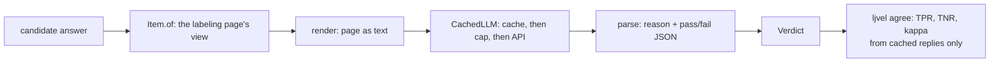

PR: [bhavya94/llm-judge-vs-expert-labels#5](https://github.com/bhavya94/llm-judge-vs-expert-labels/pull/5)

# Prompted LLM judges, cached and capped

## Summary
This PR adds the first LLM judges: Haiku 4.5 and Sonnet 5.5, each with one general prompt. A judge reads the same
view as the labeler, as text. It writes a reason, then Pass or Fail. A dry run prints the worst-case cost and spends
nothing. A paid run stays under a hard cap, and every reply is cached. So scoring the judges later costs nothing.

## How it works

- [`judges/prompted.py:21`](https://github.com/bhavya94/llm-judge-vs-expert-labels/blob/c9183de865e6de020735061b32f7ac968236f8ce/src/llm_judge_vs_expert_labels/judges/prompted.py#L21) is the prompt. It asks
  for the reason before the verdict.
- [`judges/prompted.py:33`](https://github.com/bhavya94/llm-judge-vs-expert-labels/blob/c9183de865e6de020735061b32f7ac968236f8ce/src/llm_judge_vs_expert_labels/judges/prompted.py#L33) writes the page as text: question,
  references, paragraphs with their marks, then the answer.
- [`judges/prompted.py:61`](https://github.com/bhavya94/llm-judge-vs-expert-labels/blob/c9183de865e6de020735061b32f7ac968236f8ce/src/llm_judge_vs_expert_labels/judges/prompted.py#L61) estimates the worst case.
  It counts 1 token per 3 characters and a full-length reply for every answer.
- [`judges/prompted.py:79`](https://github.com/bhavya94/llm-judge-vs-expert-labels/blob/c9183de865e6de020735061b32f7ac968236f8ce/src/llm_judge_vs_expert_labels/judges/prompted.py#L79) reads the verdict. A reply
  without one counts as Fail, and the judge counts it.
- [`llm/client.py:68`](https://github.com/bhavya94/llm-judge-vs-expert-labels/blob/c9183de865e6de020735061b32f7ac968236f8ce/src/llm_judge_vs_expert_labels/llm/client.py#L68) refuses a cache miss when there is no
  client. That is how `agree` stays offline.
- [`cli.py:93`](https://github.com/bhavya94/llm-judge-vs-expert-labels/blob/c9183de865e6de020735061b32f7ac968236f8ce/src/llm_judge_vs_expert_labels/cli.py#L93) adds a prompted judge to `agree` only when all of
  dev is cached.
- [`configs/judges.toml:16`](https://github.com/bhavya94/llm-judge-vs-expert-labels/blob/c9183de865e6de020735061b32f7ac968236f8ce/configs/judges.toml#L16) holds the cap, the model ids and the prices.
- [`tests/test_llm_judges.py:57`](https://github.com/bhavya94/llm-judge-vs-expert-labels/blob/c9183de865e6de020735061b32f7ac968236f8ce/tests/test_llm_judges.py#L57) checks that the prompt never names the writer
  or answer-F1.

## Decision log
| Decision | Options considered | Chosen | Why |
|---|---|---|---|
| What the judge sees | Its own prompt layout; the labeling page | The page, as text | Judge and labeler disagree only on judgment, not on input |
| Reason or verdict first | Verdict only; verdict then reason; reason then verdict | Reason first | The verdict follows from the reason |
| Unreadable reply | Raise; retry; count as Fail | Count as Fail, and count it | A run never stops halfway; the count shows the bias |
| Spending | Paid by default; dry run by default | Dry run by default | Nothing is spent without `--run` |
| Scoring | Call the API in `agree`; read the cache | Read the cache | Scoring is free and can repeat |
| Client | New code; copy the extraction client | Copy | It is tested and has a hard cap |

## Cost & risk
The dry run says at most $1.18 for Haiku and $3.54 for Sonnet on 200 dev answers. The project cap is $25. The
Sonnet 5.5 price in the config needs a check against the current price list. Nothing was spent in this PR.

## Open questions
- The prompt is general. Judges for each failure mode come after axial coding.
- The cache makes a rerun repeat the same reply. Variation between samples belongs in the degradation tests.
