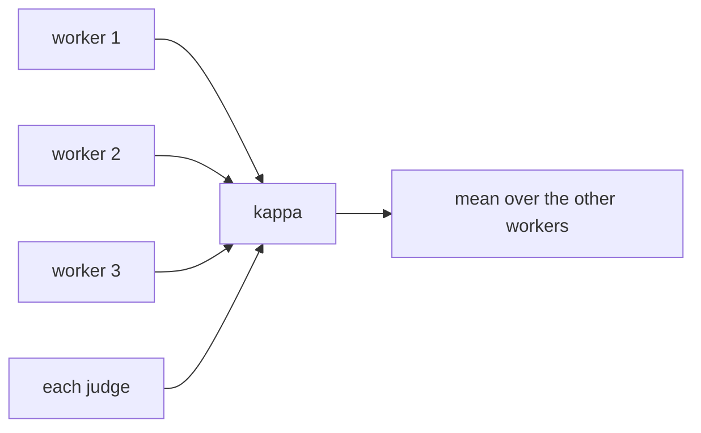

PR: [bhavya94/llm-judge-vs-expert-labels#10](https://github.com/bhavya94/llm-judge-vs-expert-labels/pull/10)

# Score every judge against one worker at a time

## Summary
The main table scores judges against the majority of three workers. That label is less noisy than one worker, so
judges looked better against the worker pairs than they are. A second table now scores every judge against one
worker at a time, as the workers are scored against each other.

## How it works

- [`cli.py:153`](https://github.com/bhavya94/llm-judge-vs-expert-labels/blob/104756f3103b6505740e2227dbd66d7ec43141b5/src/llm_judge_vs_expert_labels/cli.py#L153) builds the table. A worker is never scored against itself.
- [`tests/test_qags.py:97`](https://github.com/bhavya94/llm-judge-vs-expert-labels/blob/104756f3103b6505740e2227dbd66d7ec43141b5/tests/test_qags.py#L97) checks that rule on the real data.

## Decision log
| Decision | Options considered | Chosen | Why |
|---|---|---|---|
| Fair ceiling | Drop the pairs; leave-one-out majority; judge vs one worker | Judge vs one worker | Two other workers often tie, so a leave-one-out majority is undefined |
| Intervals | Bootstrap the mean; point estimates | Point estimates | A mean over three workers needs a different bootstrap |

## Cost & risk
No API cost. On dev, a worker reaches mean kappa 0.35–0.41 against the others. Haiku reaches 0.48 and Sonnet 0.50.
