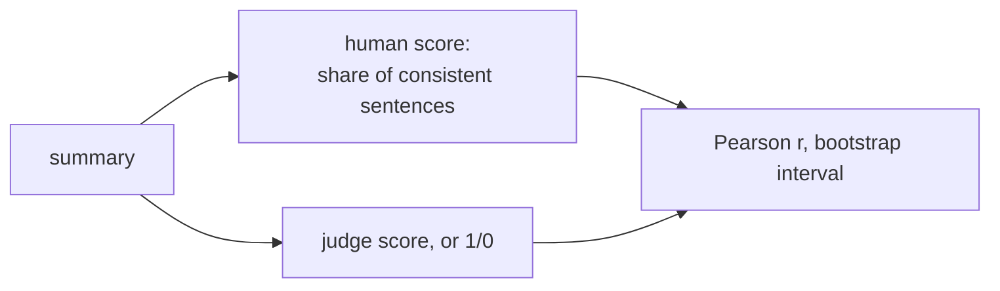

PR: [bhavya94/llm-judge-vs-expert-labels#11](https://github.com/bhavya94/llm-judge-vs-expert-labels/pull/11)

# Pearson r with the human score

## Summary
The QAGS paper reports Pearson's r between a metric and a human score. The human score is the share of a summary's
sentences that most workers call consistent. `agree` now reports the same r, so our judges compare with the paper.
A judge can return a graded score. A Pass/Fail judge counts 1 or 0.

## How it works

- [`data/qags.py:56`](https://github.com/bhavya94/llm-judge-vs-expert-labels/blob/92471986331c161715385004cefa107f384c056c/src/llm_judge_vs_expert_labels/data/qags.py#L56) is the human score.
- [`evaluation/agreement.py:56`](https://github.com/bhavya94/llm-judge-vs-expert-labels/blob/92471986331c161715385004cefa107f384c056c/src/llm_judge_vs_expert_labels/evaluation/agreement.py#L56) computes r with a bootstrap interval.
- [`cli.py:141`](https://github.com/bhavya94/llm-judge-vs-expert-labels/blob/92471986331c161715385004cefa107f384c056c/src/llm_judge_vs_expert_labels/cli.py#L141) adds the column. Workers get none, since their votes are in the human score.

## Decision log
| Decision | Options considered | Chosen | Why |
|---|---|---|---|
| Correlation | Spearman; Pearson | Pearson | The paper reports Pearson |
| Constant scores | Let numpy warn; return nan | nan, no warning | r is undefined, not an error |

## Cost & risk
No API cost. Our numbers are on dev; the paper used all summaries.
