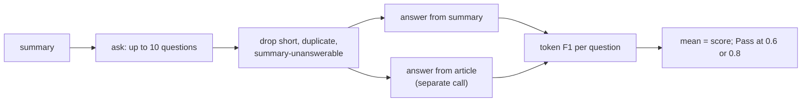

PR: [bhavya94/llm-judge-vs-expert-labels#12](https://github.com/bhavya94/llm-judge-vs-expert-labels/pull/12)

# QAGS as a judge

## Summary
QAGS checks a summary by asking questions about it. It answers them from the summary and from the article, then
compares the answers. Here Haiku writes and answers the questions in place of the paper's models. On dev it
correlates with the human score at r = 0.44 on CNN/DM and 0.37 on XSum. A prompted Haiku, with one call instead
of three, reaches 0.54 and 0.56.

## How it works

- [`judges/qa_based.py:28`](https://github.com/bhavya94/llm-judge-vs-expert-labels/blob/7c64c81a92440162e5f9872e33a10678c4fec67f/src/llm_judge_vs_expert_labels/judges/qa_based.py#L28) is the prompt that writes the questions.
- [`judges/qa_based.py:50`](https://github.com/bhavya94/llm-judge-vs-expert-labels/blob/7c64c81a92440162e5f9872e33a10678c4fec67f/src/llm_judge_vs_expert_labels/judges/qa_based.py#L50) is SQuAD's token F1.
- [`judges/qa_based.py:132`](https://github.com/bhavya94/llm-judge-vs-expert-labels/blob/7c64c81a92440162e5f9872e33a10678c4fec67f/src/llm_judge_vs_expert_labels/judges/qa_based.py#L132) filters the questions and pairs the answers.
- [`configs/judges.toml:31`](https://github.com/bhavya94/llm-judge-vs-expert-labels/blob/7c64c81a92440162e5f9872e33a10678c4fec67f/configs/judges.toml#L31) sets the model, question count and cuts.
- [`tests/test_qa_based.py:67`](https://github.com/bhavya94/llm-judge-vs-expert-labels/blob/7c64c81a92440162e5f9872e33a10678c4fec67f/tests/test_qa_based.py#L67) checks that the article call never sees the summary.

## Decision log
| Decision | Options considered | Chosen | Why |
|---|---|---|---|
| Question writer | Small QG model; LLM | Haiku | One call writes fewer, cleaner questions |
| Answers | One call for both texts; two calls | Two calls | The article answer must not see the summary |
| Unanswerable | Special rule; plain F1 | Plain F1 | "unanswerable" shares no word with a real answer |
| Cuts | Fixed in advance; from dev scores | 0.6 and 0.8 from dev | Best dev kappa per dataset; test will show the bias |

## Cost & risk
$0.73 for 945 calls on dev. One summary had an unreadable reply. Spend so far is $2.51 of the $25 cap.

## Open questions
- A mean over about 6 questions dilutes one wrong answer. A minimum might fit the label better on CNN/DM.
- The paper writes 100 questions and keeps 20. Ours averages about 6 on CNN/DM and 3 on XSum.
