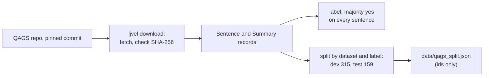

PR: [bhavya94/llm-judge-vs-expert-labels#6](https://github.com/bhavya94/llm-judge-vs-expert-labels/pull/6)

# QAGS human labels: pinned download, records, frozen split

## Summary
The project's human labels now come from the QAGS release (Wang, Cho and Lewis, 2020). There are 474 summaries
of CNN/DM and XSum articles. Three crowd workers judged every summary sentence against its article. Hand-labeling
300 QASPER answers cost more time than it gave. QAGS also gives a published judge to compare against.

## How it works

- [`configs/qags.toml:3`](https://github.com/bhavya94/llm-judge-vs-expert-labels/blob/e1eadb5edd296b3826281ed1e4827a8b3f860ae8/configs/qags.toml#L3) pins the commit and each file's SHA-256.
- [`data/qags.py:79`](https://github.com/bhavya94/llm-judge-vs-expert-labels/blob/e1eadb5edd296b3826281ed1e4827a8b3f860ae8/src/llm_judge_vs_expert_labels/data/qags.py#L79) downloads missing files and deletes any file whose hash differs.
- [`data/qags.py:29`](https://github.com/bhavya94/llm-judge-vs-expert-labels/blob/e1eadb5edd296b3826281ed1e4827a8b3f860ae8/src/llm_judge_vs_expert_labels/data/qags.py#L29) builds the label. A tie is not a majority.
- [`data/qags.py:106`](https://github.com/bhavya94/llm-judge-vs-expert-labels/blob/e1eadb5edd296b3826281ed1e4827a8b3f860ae8/src/llm_judge_vs_expert_labels/data/qags.py#L106) splits each (dataset, label) group with its own seeded shuffle.
- [`tests/test_qags.py:90`](https://github.com/bhavya94/llm-judge-vs-expert-labels/blob/e1eadb5edd296b3826281ed1e4827a8b3f860ae8/tests/test_qags.py#L90) fails if a fresh draw differs from the frozen split.

## Decision log
| Decision | Options considered | Chosen | Why |
|---|---|---|---|
| Gold labels | My own 300 labels; QAGS crowd labels | QAGS | Saves about 6 hours; a published judge to compare |
| Data in the repo | Commit the files; download at setup | Download | The QAGS repo has no license file |
| Summary label | Mean of votes; majority on every sentence | Majority on every sentence | Binary, and one bad sentence makes a summary wrong |
| Split | Random; stratified by dataset and label | Stratified | Dev and test keep the same mix |
| Repo name | Rename; keep | Keep | Your decision; the name still fits a human-label study |

## Cost & risk
No API cost. The labels come from crowd workers, not experts. Workers agree on all three votes for 70% of
CNN/DM sentences but only about half of XSum sentences.

## Open questions
- The QASPER sample and labeling page stay parked on main. A later cleanup could remove them.
