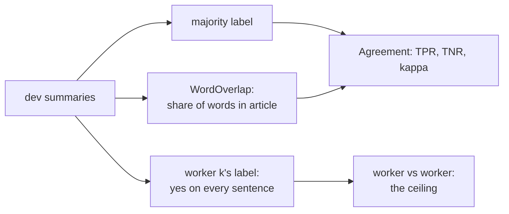

PR: [bhavya94/llm-judge-vs-expert-labels#7](https://github.com/bhavya94/llm-judge-vs-expert-labels/pull/7)

# QAGS baselines: word overlap and the workers' ceiling

## Summary
This PR adds the first judges for the QAGS labels and the human ceiling. A word-overlap judge passes a summary
when enough of its words appear in the article. The ceiling is one crowd worker's label against another's.
`ljvel agree` scores both on dev, per dataset and overall.

## How it works

- [`judges/code.py:25`](https://github.com/bhavya94/llm-judge-vs-expert-labels/blob/f0d5962419219c7e42de871957ddd9ea4cf9edce/src/llm_judge_vs_expert_labels/judges/code.py#L25) is the overlap judge. Its reason names the missing words.
- [`data/qags.py:55`](https://github.com/bhavya94/llm-judge-vs-expert-labels/blob/f0d5962419219c7e42de871957ddd9ea4cf9edce/src/llm_judge_vs_expert_labels/data/qags.py#L55) gives one worker's label. Position k is whoever answered k-th.
- [`cli.py:89`](https://github.com/bhavya94/llm-judge-vs-expert-labels/blob/f0d5962419219c7e42de871957ddd9ea4cf9edce/src/llm_judge_vs_expert_labels/cli.py#L89) prints the three worker pairs and every judge, per dataset.

## Decision log
| Decision | Options considered | Chosen | Why |
|---|---|---|---|
| Ceiling | Fleiss' kappa; worker vs worker | Worker vs worker | Same table and measures as the judges |
| Baseline | ROUGE; numbers check; word overlap | Word overlap | Numbers check caught almost nothing on dev |
| Cuts | Tuned on dev; two fixed cuts | 0.9 and 1.0 | Baselines, not tuned results |
| QASPER judges | Keep; remove | Remove | Nothing uses them now |

## Cost & risk
No API cost. Dev results: two workers agree at kappa 0.32–0.44 overall. Overlap reaches 0.07–0.23 on CNN/DM,
because those summaries copy the article. On XSum the 0.9 cut reaches 0.28, inside the worker range.

## Open questions
- A judge is scored against the majority of three, which is less noisy than one worker. So a judge can beat the
  worker pairs, and the ceiling is soft.
