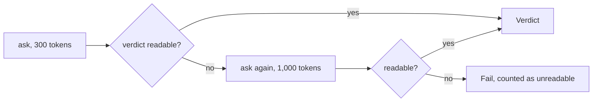

PR: [bhavya94/llm-judge-vs-expert-labels#9](https://github.com/bhavya94/llm-judge-vs-expert-labels/pull/9)

# Retry a cut-off judge reply

## Summary
On dev, Sonnet wrote past 300 tokens on 11 of 315 summaries. Each reply stopped before the verdict and counted as
Fail. A reply with no readable verdict is now asked again once, with a 1,000-token limit. The retry fixed all 11
for $0.08.

## How it works

- [`llm/client.py:60`](https://github.com/bhavya94/llm-judge-vs-expert-labels/blob/0fff5f403db803ed64bd6c76affd290aa54e587e/src/llm_judge_vs_expert_labels/llm/client.py#L60) takes a token limit per call. The limit is part of the cache key.
- [`judges/prompted.py:64`](https://github.com/bhavya94/llm-judge-vs-expert-labels/blob/0fff5f403db803ed64bd6c76affd290aa54e587e/src/llm_judge_vs_expert_labels/judges/prompted.py#L64) retries once.
- [`tests/test_llm_judges.py:61`](https://github.com/bhavya94/llm-judge-vs-expert-labels/blob/0fff5f403db803ed64bd6c76affd290aa54e587e/tests/test_llm_judges.py#L61) checks the two limits in order.

## Decision log
| Decision | Options considered | Chosen | Why |
|---|---|---|---|
| Fix | Raise the limit for all; retry cut-off replies | Retry | Only 11 calls are paid again; the rest stay cached |
| Retries | Several; one | One | A second cut-off is rare and still counted |

## Cost & risk
$0.08. A judge that writes long reasons costs more on the retried replies only.
