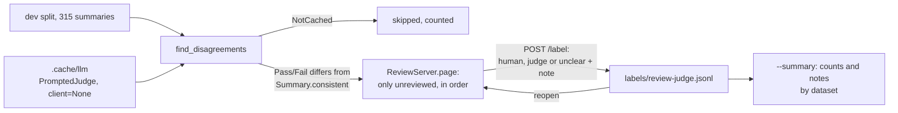

PR: [bhavya94/llm-judge-vs-expert-labels#13](https://github.com/bhavya94/llm-judge-vs-expert-labels/pull/13)

# The review page: who was right where a judge and the human label disagree

## Summary
Agreement numbers say how often a judge differs from the human majority label. They do not say why. This PR adds a
local page for the summaries where the two differ. For each one, the reviewer reads the article, the votes and the
judge's reason, then marks human, judge or unclear and writes a note. The notes become failure modes of the judge,
or of the crowd labels. With Sonnet's cached verdicts, the page holds 60 of the 315 dev summaries, and the cache misses none.

## How it works

- [`src/llm_judge_vs_expert_labels/cli.py:188`](https://github.com/bhavya94/llm-judge-vs-expert-labels/blob/055ed1eaf32384e1c9efcc8fa3b00efd94228e73/src/llm_judge_vs_expert_labels/cli.py#L188) builds the judge with no client. A cache miss raises `NotCached`, so
  the command can never spend money.
- [`src/llm_judge_vs_expert_labels/review/disagreements.py:38`](https://github.com/bhavya94/llm-judge-vs-expert-labels/blob/055ed1eaf32384e1c9efcc8fa3b00efd94228e73/src/llm_judge_vs_expert_labels/review/disagreements.py#L38) keeps a summary when the verdict differs from the human
  label. It counts a cache miss and moves on.
- [`src/llm_judge_vs_expert_labels/review/disagreements.py:29`](https://github.com/bhavya94/llm-judge-vs-expert-labels/blob/055ed1eaf32384e1c9efcc8fa3b00efd94228e73/src/llm_judge_vs_expert_labels/review/disagreements.py#L29) builds what the page shows. It holds the id, a hash,
  but no index, so nothing gives the summary's position in the split.
- [`src/llm_judge_vs_expert_labels/review/disagreements.py:95`](https://github.com/bhavya94/llm-judge-vs-expert-labels/blob/055ed1eaf32384e1c9efcc8fa3b00efd94228e73/src/llm_judge_vs_expert_labels/review/disagreements.py#L95) subclasses the labeling server. The HTTP handler, the
  JSON-only POST and the one-request-at-a-time save come with no edit to the labeling code.
- [`src/llm_judge_vs_expert_labels/review/disagreements.py:105`](https://github.com/bhavya94/llm-judge-vs-expert-labels/blob/055ed1eaf32384e1c9efcc8fa3b00efd94228e73/src/llm_judge_vs_expert_labels/review/disagreements.py#L105) sends the page only the summaries with no saved
  review. The page saves in order, so a reopened page resumes after the last saved one.
- [`src/llm_judge_vs_expert_labels/review/disagreements.py:68`](https://github.com/bhavya94/llm-judge-vs-expert-labels/blob/055ed1eaf32384e1c9efcc8fa3b00efd94228e73/src/llm_judge_vs_expert_labels/review/disagreements.py#L68) refuses a review without a note. The notes are the
  output.
- [`src/llm_judge_vs_expert_labels/review/disagreements.py:112`](https://github.com/bhavya94/llm-judge-vs-expert-labels/blob/055ed1eaf32384e1c9efcc8fa3b00efd94228e73/src/llm_judge_vs_expert_labels/review/disagreements.py#L112) refuses an id that is not a string. A list as the id
  used to crash the request with no reply.
- [`src/llm_judge_vs_expert_labels/review/template.html:92`](https://github.com/bhavya94/llm-judge-vs-expert-labels/blob/055ed1eaf32384e1c9efcc8fa3b00efd94228e73/src/llm_judge_vs_expert_labels/review/template.html#L92) ignores a second save while one is in flight. Without it,
  a double press of the save keys skipped a summary.
- [`src/llm_judge_vs_expert_labels/review/template.html:111`](https://github.com/bhavya94/llm-judge-vs-expert-labels/blob/055ed1eaf32384e1c9efcc8fa3b00efd94228e73/src/llm_judge_vs_expert_labels/review/template.html#L111) keeps the `h`, `j` or `u` key out of the note box when
  it moves the focus there.
- [`configs/labeling.toml:11`](https://github.com/bhavya94/llm-judge-vs-expert-labels/blob/055ed1eaf32384e1c9efcc8fa3b00efd94228e73/configs/labeling.toml#L11) sets the review file and its own port, 8766. The labeling page keeps 8765, so both can run.
- [`tests/test_review.py:78`](https://github.com/bhavya94/llm-judge-vs-expert-labels/blob/055ed1eaf32384e1c9efcc8fa3b00efd94228e73/tests/test_review.py#L78) checks that a review saved in an `xsum`-only run hides no earlier `cnndm` summary.

## Decision log
| Decision | Options considered | Chosen | Why |
|---|---|---|---|
| Where the code lives | Inside `labeling/`; a new `review/` package | New package | `labeling/` may import only `data`. The review needs the judges and `NotCached`. |
| Reuse of the server | Extract the handler; subclass `LabelingServer` | Subclass | The handler needs only `page()` and `label()`. Extracting it would re-indent about 40 lines. |
| Resume | After the furthest saved item; at the first unreviewed item | First unreviewed | They match when the reviewer saves in order. After an `xsum`-only run, "furthest" would skip every `cnndm` summary. |
| Note | Optional; required | Required | The notes are what the page is for. |
| Port | Share 8765; a flag; its own port in config | Own port, 8766 | The labeling page was running on 8765 during the demo, and the review command failed to bind. |
| Navigation | Back and forward; forward only | Forward only | The request asked for "then next". The file keeps the newest row per summary, so a back button can come later. |

## Cost & risk
No API cost: the judge reads the cache only. The cost is the reviewer's time, about one minute per summary, so about
an hour for Sonnet's 60.
- The change is 392 lines, above the 300-line guide. The page template alone is 116 of them.
- A wrong click cannot be undone on the page. The fix is to delete that line from the review file and reopen.
- New verdicts in the cache change the list. A saved review of a summary that no longer disagrees still counts in
  `--summary`.

## Open questions
- Should the page mix the datasets in a seeded order? Now all `cnndm` summaries come first, so a review that
  stops halfway covers few `xsum` summaries.
- Should the page get a back button, so the reviewer can fix a wrong click without editing the file?
- Should `--summary` count only the reviews of summaries that still disagree?
